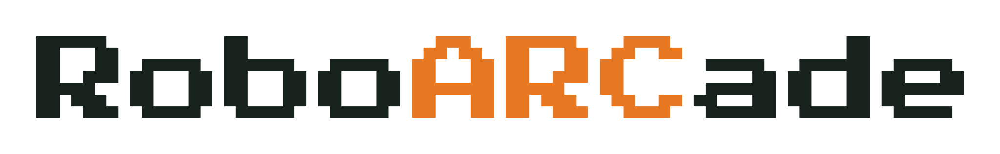

<p align="center">
  <a href="https://roboarcade.org"></a>
</p>

See results, videos, and full traces at [roboarcade.org](https://roboarcade.org).

## Quickstart

Requires Linux x86_64, an EGL-capable GPU driver, Git, curl, xz, and Bubblewrap
with permission to create user namespaces. **Setup runs without sudo**; missing
host prerequisites must be provided by your administrator. Installing the Codex
runtime also requires Node.js and npm if Codex is not already installed.

**1. Clone the repository.**

```bash
git clone https://github.com/Satvik1701/RoboARCade.git roboarcade
cd roboarcade
mkdir -p secrets
```

**2. Add your keys.** Save a Hugging Face token and **one provider API key** as
plain text in the files below. The `secrets/` folder is gitignored.

| Key | File |
|---|---|
| Hugging Face | `secrets/hf_key.txt` |
| Anthropic | `secrets/anthropic_key.txt` |
| OpenAI | `secrets/openai_key.txt` |
| Gemini | `secrets/gemini_key.txt` |

**3. Set up and run.** Replace `MODEL_ID` with a model your key can access.
Setup installs Blender, Python dependencies, the required agent runtime, and assets.

```bash
bash scripts/setup.sh
source set_env.sh
python -m core.run_eval --model MODEL_ID --seeds 1
```

Defaults: **tidy_counter · Multi-view RGBD · Blender · API billing**.
Use `--task TASK` to choose another task. Runs are recorded, graded, and rendered;
`python -m dashboard` opens the dashboard at `http://localhost:8400`.

---

### Additional Interfaces: VIA

[VIA (Visual Interface Agent)](https://via.hengyuanhu.com/) provides a visual
interface for robot control. After Quickstart, download Chromium and select VIA:

```bash
bash scripts/setup.sh --via
source set_env.sh
python -m core.run_eval --model MODEL_ID --interface via_cam --seeds 1
```

Use `via_bimanual_cam` for two-arm tasks. The keys and sandbox are the same.
VIA also needs Chromium's [Linux system dependencies](https://playwright.dev/python/docs/browsers#install-system-dependencies)
on the host; setup checks browser startup without installing system packages.

### Prototyping with a plan

For a Claude or Codex subscription, only the HF key is required. Replace `RUNTIME`
with `claude` or `codex`, then sign in when prompted:

```bash
bash scripts/setup.sh --plan RUNTIME
source set_env.sh
python -m core.accounts login RUNTIME myplan
python -m core.run_eval --model MODEL_ID --plan myplan --seeds 1
```

Credentials are isolated from personal CLI history and settings. See
[Accounts](docs/ACCOUNTS.md) for multiple plans and rate-limit behavior, including
Claude's fallback to an available API key. Add `--via` to setup if needed.

### Assets and docs

Setup downloads finished [HF assets](https://huggingface.co/datasets/roboarcade/roboarcade-assets);
it never rebuilds collision meshes. For a faster MuJoCo-only test, add
`--render mujoco --no-video`.

[Tasks](tasks/README.md) · [Accounts](docs/ACCOUNTS.md) · [Sandbox](docs/SANDBOX.md) · [Gemini](docs/antigravity.md)

#### Asset credits

The meshes, textures and robot models in [`roboarcade/roboarcade-assets`](https://huggingface.co/datasets/roboarcade/roboarcade-assets)
come from these projects. We thank their authors; each project's own license and terms apply to its files.

| Source | Tasks | What we use | License |
|---|---|---|---|
| [AutoBio](https://github.com/autobio-bench/AutoBio/) | PCR setup, Start incubation, Vortex sample | Digitized lab instruments and consumables. You can also get them from the AutoBio repository. | see the AutoBio repository |
| [Fabrica](https://github.com/yunshengtian/Fabrica) | Beam, Cooling manifold, Gamepad, Stool | Assembly parts | MIT |
| [LIBERO](https://github.com/Lifelong-Robot-Learning/LIBERO) | Serve warm drinks, Start making breakfast, Tidy counter | Kitchen scenes and objects | MIT |
| [OGBench](https://github.com/seohongpark/ogbench) | Lights Out (6 by 7) | The puzzle | MIT |
| [SPD](https://spd.bot) | Toss bottles in bin, Cup pyramid, Handover dominos, Jenga tower, Hang mugs and rack plates | Bimanual VR teleoperation scenes and objects | courtesy of the SPD authors |
| [RoboDojo](https://github.com/RoboDojo-Benchmark/RoboDojo) | Strongbox, Organize table and plug in charger, Pack tools into toolboxes, Sort Lego bricks | Task objects | MIT |
| [ABC](https://github.com/amazon-far/abc) | Sort Lego bricks | Lego brick models | Apache-2.0 |
| [robomimic](https://github.com/ARISE-Initiative/robomimic) | Square nut assembly | The robosuite nut assembly scene | MIT |
| [MuJoCo Menagerie](https://github.com/google-deepmind/mujoco_menagerie) | all Panda tasks | Franka Emika Panda | Apache-2.0 |
| [I2RT](https://github.com/i2rt-robotics/i2rt) | all YAM tasks | YAM arm, via MuJoCo Menagerie | MIT |
